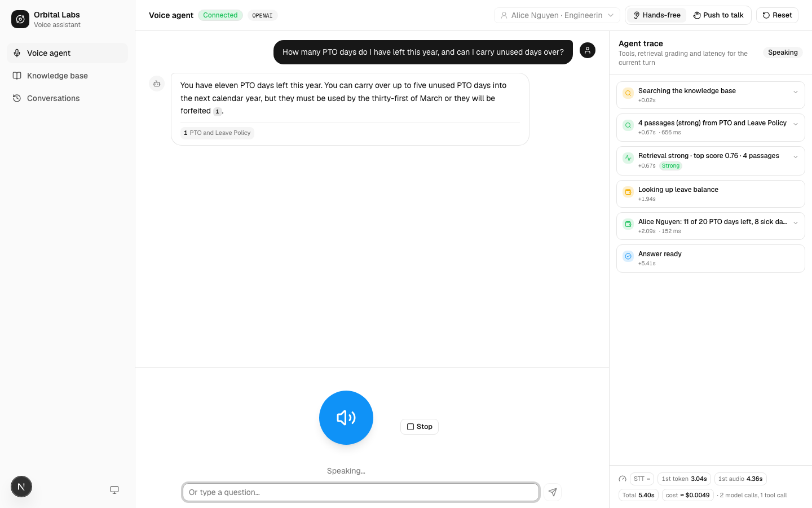
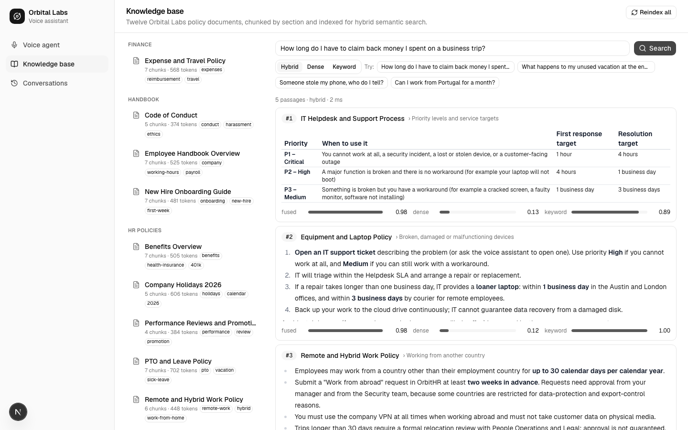
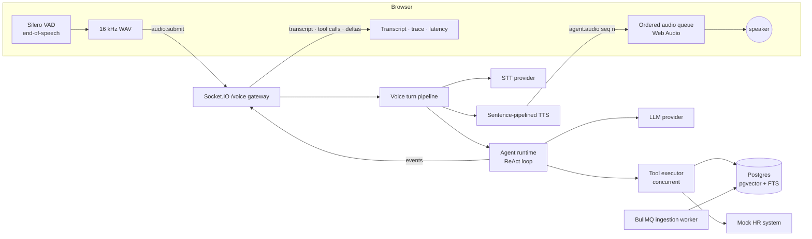
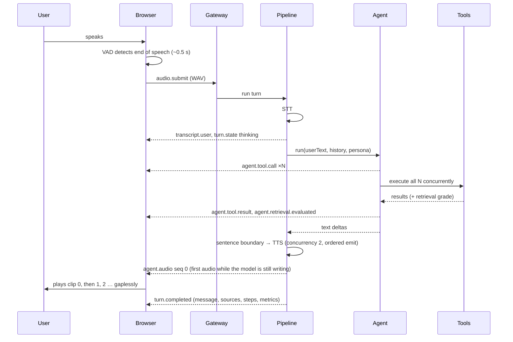

# Orbital Voice Agent

A voice-to-voice AI assistant for a fictional company's employee handbook. You talk, it listens, searches a knowledge base, calls tools when it needs to, and talks back, with every answer grounded in cited sources and every step of its reasoning visible in the UI.

Built for the _Senior Software Engineer: Voice-to-Voice Agent with RAG, Semantic Search & Agentic AI_ assessment with NestJS, Next.js, Postgres + pgvector, Redis + BullMQ and the OpenAI platform.

| Voice agent with live trace                      | Knowledge base and semantic search                       |
| ------------------------------------------------ | -------------------------------------------------------- |
|  |  |

## Documentation

- **[Architecture & features](docs/architecture-and-features.pdf)**: system, flows and data diagrams, the full feature list, contracts, latency, cost, testing and the key decisions.
- **[Testing guide](docs/testing-guide.pdf)**: what to set up, what to say for each scenario and tool, where to verify the effects, automated suites and troubleshooting.
- Sources for both live in `docs/src`; regenerate with `pnpm --filter @voice-agent/web docs:pdf`.

## What it does

- **Voice in, voice out.** On-device voice-activity detection (Silero VAD running in the browser) finds the end of your sentence, the audio goes to speech-to-text, the agent answers, and the reply is spoken back sentence by sentence while the model is still generating. Interrupt it by speaking (barge-in), or use push-to-talk or the text box.
- **Grounded answers with citations.** A hybrid retriever (vector similarity + full-text search, fused with reciprocal rank fusion) finds passages in a twelve-document knowledge base. Answers cite `[1]`, `[2]` chips that open the exact passage.
- **An agent, not a chatbot.** A ReAct-style loop with seven tools: knowledge-base search, current date/time, business-day counting, calculator, leave balance from a mock HR system, ticket lookup through a ticketing API, and support-ticket creation. Independent tool calls run concurrently; the loop continues until the model has what it needs. Side-effecting actions require the user's confirmation first.
- **Retrieval it can doubt.** Every search is graded _strong / weak / none_ from embedding similarity and cross-channel agreement. The agent reformulates on _weak_ and declines to invent policies on _none_.
- **Conversation memory.** Token-budgeted history plus a persona (name, employee id, department, timezone) so follow-ups like "and what about sick days?" work and the agent never asks for things it already knows.
- **Observability built in.** Per-turn latency (speech-to-text, first token, first audio, total), tool calls with arguments and results, and retrieval grades are streamed to a trace panel as they happen.
- **Runs with or without an API key.** Deterministic mock providers (a keyword-driven model, feature-hashing embeddings, replayed transcription, a synthesized chime) exercise the entire pipeline offline. Add an OpenAI key and the same code uses real models.

## Quick start

Prerequisites: Node 22+, pnpm 10, Docker Desktop.

```bash
git clone <this repo> && cd voice-rag-agent
pnpm bootstrap     # installs, creates .env, starts Postgres + Redis, migrates, seeds + indexes the knowledge base
pnpm dev           # API on http://localhost:4000, web app on http://localhost:3000
```

Open http://localhost:3000, click the orb, allow the microphone, and ask a question. The API's OpenAPI docs are at http://localhost:4000/api/docs.

To use real models, put your key in the root `.env` and re-embed the knowledge base:

```bash
OPENAI_API_KEY=sk-...   # in .env; AI_PROVIDER auto-selects "openai" when a key is present
pnpm db:seed             # re-indexes with text-embedding-3-small (documents remember their embedding model)
```

Model names, voice, retrieval depth and agent step budget are all environment variables (see `.env.example`).

> Without a key the app runs in **mock mode**: the "model" is a small scripted planner, so it is good for demonstrating the pipeline (tools, citations, abstention, voice round-trip) but not for open-ended questions. Mock transcription replays six demo utterances in order, so use the text box for free-form input in that mode.

## Demo script

The six scenarios the assessment asks for, with phrases that work well:

| #   | Scenario                  | Say                                                                                                                                | What to look for                                                                                                                                       |
| --- | ------------------------- | ---------------------------------------------------------------------------------------------------------------------------------- | ------------------------------------------------------------------------------------------------------------------------------------------------------ |
| 1   | Voice conversation        | "What are the core working hours for remote employees?"                                                                            | Orb cycles listening → thinking → speaking; transcript shows both sides.                                                                               |
| 2   | Knowledge-grounded answer | "How many vacation days do new employees get, and can I carry unused days over?"                                                   | Citation chips; the sources sheet shows the PTO policy passages.                                                                                       |
| 3   | Semantic retrieval        | "How long do I have to claim back money I spent on a business trip?"                                                               | The expense policy says "submitted within 30 days": no word overlap with the question.                                                                 |
| 4   | Agentic execution         | "I'd like to take the last week of December off. Do I have enough PTO left, and which of those days are already company holidays?" | Trace shows `get_current_datetime`, `search_knowledge_base`, `get_leave_balance` and `calculate` across several steps before the answer.               |
| 4b  | Confirmed action          | "My laptop screen is cracked, what should I do?" then "Yes please, high priority"                                                  | Policy answer, an offer to open a ticket, then `create_support_ticket` runs only after your confirmation; the ticket appears at `GET /api/hr/tickets`. |
| 5   | Contextual follow-up      | After #2: "And what about sick days?"                                                                                              | The agent resolves the follow-up from history without re-asking.                                                                                       |
| 6   | Insufficient information  | "What's the policy on bringing dogs to the office?"                                                                                | Retrieval graded _weak/none_; the agent says the handbook does not cover it and suggests who to ask.                                                   |

Switch personas (top right) to see identity-aware tools: Bob in Sales has a different balance than Alice in Engineering, and nobody is ever asked for their employee id.

## Architecture

```
voice-rag-agent/
├─ apps/
│  ├─ api/            NestJS 11 · REST + Socket.IO · agent runtime · hybrid RAG · tools · BullMQ worker
│  └─ web/            Next.js 16 · React 19 · Tailwind 4 · shadcn/ui · Zustand · Silero VAD · Web Audio
├─ packages/
│  ├─ contracts/      Zod schemas → DTO types, socket event map, tool argument schemas (single source of truth)
│  └─ config/         shared tsconfig / ESLint bases
├─ docker/            Postgres 17 + pgvector, Redis 7
└─ scripts/           bootstrap, infra checks
```



### Backend layering (NestJS)

Each module follows the same shape, so the codebase is uniform and every folder exports through an `index.ts` barrel:

| Layer          | Responsibility                                          | Examples                                                                                              |
| -------------- | ------------------------------------------------------- | ----------------------------------------------------------------------------------------------------- |
| Presentation   | Validate DTOs, map to/from contracts, no business logic | `KnowledgeController`, `VoiceGateway`                                                                 |
| Application    | Use-cases and orchestration                             | `AgentRuntime`, `VoiceTurnPipeline`, `IngestionService`, `RetrievalService`                           |
| Domain         | Pure logic and ports                                    | `DocumentChunker`, `reciprocalRankFusion`, `RetrievalEvaluator`, `Tool`, `LlmProvider`, `SttProvider` |
| Infrastructure | Adapters and repositories                               | Drizzle repositories, OpenAI adapters, mock adapters, BullMQ processor                                |

DTOs are generated from the shared Zod schemas with `nestjs-zod`, which gives request validation, response serialization and OpenAPI docs from one definition that the web app also imports for its types.

### A voice turn, end to end



## Latency design

The pipeline is cascaded (STT → LLM → TTS) rather than a single speech-to-speech model, so that the agent loop, retrieval grading and citations live in this codebase where they can be tested and shown. Latency is handled by overlapping stages and by avoiding model round-trips:

| Stage           | Technique                                                                                                                                                                                                                                                                                    |
| --------------- | -------------------------------------------------------------------------------------------------------------------------------------------------------------------------------------------------------------------------------------------------------------------------------------------- |
| End of speech   | Silero VAD in the browser with ~650 ms trailing silence; only the speech segment is uploaded as 16 kHz WAV.                                                                                                                                                                                  |
| Speech-to-text  | `gpt-4o-transcribe` with a domain vocabulary prompt. In our benchmark it answered in ~1.0 s versus ~1.4–2.2 s for the mini model, for +$0.003 per minute.                                                                                                                                    |
| Eager retrieval | The user's message is searched before the first model call (~0.3 s) and the passages are injected into the prompt. Simple questions then need **one** model call instead of two.                                                                                                             |
| First token     | Non-reasoning model (`gpt-4.1-mini` by default), compact prompt, streaming, replies capped at 400 tokens. Each model call costs ~1.0–1.5 s to first token from this network.                                                                                                                 |
| Tools           | All tool calls of a model step run concurrently; hybrid search runs the vector and keyword channels (for up to three phrasings) in parallel inside Postgres.                                                                                                                                 |
| First audio     | Text is split at sentence boundaries as it streams; each sentence is synthesized immediately (two in flight) and the audio is **streamed as raw PCM chunks** (first chunk after ~100 ms of audio) in strict order. The user hears the first words before the sentence finishes synthesizing. |
| Barge-in        | Real speech during playback cancels the turn through an `AbortSignal` that reaches the model call, the tools and the TTS stream.                                                                                                                                                             |

Measured on this machine with the OpenAI providers (network round-trip to OpenAI ≈ 300 ms):

| Turn                                                                                      | Model calls | First token | First audio                                          | Total | Est. cost |
| ----------------------------------------------------------------------------------------- | ----------- | ----------- | ---------------------------------------------------- | ----- | --------- |
| "How many vacation days do new employees get, and can I carry unused days over?" (text)   | 1           | 1.4 s       | –                                                    | 1.9 s | $0.0009   |
| December leave: holidays + balance + day count (text)                                     | 2           | 2.8 s       | –                                                    | 3.4 s | $0.0021   |
| "Can I bring my dog?" → weak grade → reformulate → abstain (text)                         | 2           | 3.0 s       | –                                                    | 3.3 s | $0.0014   |
| "What are the core working hours for remote employees?" (voice, 6 s utterance; STT 1.3 s) | 1           | 3.1 s       | 4.5 s (first PCM chunk 0.8 s after synthesis starts) | 6.0 s | $0.005    |

Every turn's `sttMs`, `firstTokenMs`, `firstAudioMs`, `totalMs`, token counts and estimated cost are stored with the message and shown in the UI. Roughly 300–400 ms of every model, transcription and speech call above is network round-trip from this test location; a reviewer closer to OpenAI's regions will see lower numbers. Mock mode completes a tool round in under 200 ms, which is handy for checking the plumbing.

## Cost

Per turn with the default models (list prices, estimated by the app and shown in the UI):

| Component                             | Price basis                                        | Typical turn                                       |
| ------------------------------------- | -------------------------------------------------- | -------------------------------------------------- |
| Chat (`gpt-4.1-mini`)                 | $0.40 / 1M input ($0.10 cached), $1.60 / 1M output | 2–5k prompt tokens, ~100 output → **$0.001–0.002** |
| Speech-to-text (`gpt-4o-transcribe`)  | $0.006 / minute                                    | 6 s utterance → **$0.0006**                        |
| Text-to-speech (`gpt-4o-mini-tts`)    | ≈ $0.015 / minute of speech                        | 60-word reply → **$0.004**                         |
| Embeddings (`text-embedding-3-small`) | $0.02 / 1M tokens                                  | query ≈ $0.0000003; whole knowledge base ≈ $0.0002 |

So a spoken turn costs about **half a cent** and a typed turn about a tenth of a cent; a hundred-turn demo is under a dollar. Levers that keep it low: eager retrieval (one model call instead of two), a 400-token reply cap, a 4 000-token history window, OpenAI's automatic prompt caching (the stable system prompt and tool schemas are billed at a quarter price on repeat calls), no LLM reranker by default, and mock providers in every automated test so CI never spends anything. Switch `OPENAI_CHAT_MODEL` to `gpt-4o-mini` or `gpt-4.1-nano` to cut the chat cost further at some quality loss.

## Retrieval (RAG)

1. **Loading**: markdown documents with front-matter in `apps/api/knowledge-base`. Content is checksummed so unchanged documents are skipped.
2. **Chunking**: split by headings into sections (keeping the heading path), then recursively by paragraph → sentence to ~400 tokens with sentence-level overlap; tiny sections are merged into their neighbour. Each chunk is embedded with a **contextual header** (`Document: … / Section: …`) so a sentence like "up to five days carry over" also carries "PTO policy › Carryover" semantics.
3. **Indexing**: `text-embedding-3-small` vectors in pgvector (HNSW, cosine) and a generated `tsvector` column (GIN) in the same row.
4. **Hybrid search**: the dense channel (cosine similarity) and the keyword channel run concurrently for one to three query phrasings supplied by the agent. The keyword channel takes candidates from the GIN index and ranks them with **BM25** computed over the stored lexemes (Postgres' `ts_rank` has no inverse-document-frequency term, so chunks that merely repeat a common word used to win). Results are fused with **weighted reciprocal rank fusion** (k = 60, keyword weight 0.7) and returned with the fused score and both channel scores. Modes `hybrid | dense | sparse` are exposed in the API and the search playground.
5. **Grading**: `RetrievalEvaluator` classifies a result set as strong / weak / none using the embedding provider's calibrated similarity thresholds and whether the top passage was found by both channels. The grade is attached to the tool result and streamed to the UI.
6. **Citations**: passages are numbered per turn; the answer's `[n]` markers are resolved to sources, renumbered in order of appearance, and stripped from the spoken text.
7. **Async ingestion**: `POST /api/knowledge/reindex` and document uploads enqueue BullMQ jobs with progress; the seed script runs the same pipeline inline.

`pnpm eval:retrieval` runs nineteen deliberately paraphrased questions against the index and reports hit@1, hit@3 and MRR for every mode. With the deterministic mock embeddings (no API key):

| mode   | hit@1 | hit@3 | MRR  |
| ------ | ----- | ----- | ---- |
| hybrid | 0.89  | 0.94  | 0.91 |
| dense  | 0.72  | 0.89  | 0.81 |
| sparse | 0.67  | 0.89  | 0.78 |

Even with lexical mock vectors, fusing the channels beats either alone; with real embeddings the dense channel carries the paraphrase cases.

## The agent

- **Loop**: pre-fetch passages for the message → stream a model step → if it requested tools, run them all concurrently with per-tool timeouts → append results → repeat, up to `AGENT_MAX_STEPS` (6). Failures become structured `{ ok: false, error }` payloads the model can recover from. The pre-fetch is skipped for short confirmations ("yes please").
- **Tools** (`apps/api/src/modules/tools/implementations`), seven in total:

  | Tool                    | Purpose                                                                                   | Side effects       |
  | ----------------------- | ----------------------------------------------------------------------------------------- | ------------------ |
  | `search_knowledge_base` | hybrid search for 1–3 phrasings; returns graded, numbered passages and guidance           | none               |
  | `get_current_datetime`  | date, weekday and time in the user's timezone                                             | none               |
  | `calculate`             | sandboxed arithmetic (mathjs with code-execution functions removed)                       | none               |
  | `get_leave_balance`     | PTO and sick balance from the (simulated, 150 ms) HR system; defaults to the current user | none               |
  | `create_support_ticket` | opens a ticket; the prompt requires explicit confirmation first                           | writes to Postgres |

  Tools implement one `Tool` interface with a Zod argument schema; the registry converts schemas to JSON Schema for the model, and the executor validates arguments before running anything.

- **Prompting**: the system prompt carries the persona, grounding rules (cite, reformulate on weak, abstain on none, never invent), tool policy (parallelize independent calls, confirm before side effects) and a voice style (short, no markdown, numbers spoken naturally).
- **Memory**: the last turns that fit a 6 000-token budget, oldest first, plus a conversation summary slot. Tool traces are not replayed; the assistant's final answers already contain the resolved facts.

## Web app

- `/` voice agent: state-driven orb (idle, listening with level meter, transcribing/thinking/using tools, speaking), hands-free or push-to-talk, text fallback, persona selector, reset, transcript with citation chips and a sources sheet, and the live agent trace with latency badges.
- `/knowledge`: documents grouped by category with chunk statistics, a search playground with per-channel scores, document viewer, and a reindex button that follows BullMQ job progress.
- `/conversations`: history, transcript with sources and metrics, "continue by voice".
- `/tools`: tools & tickets dashboard: the tool catalogue exactly as the model sees it (schemas, side-effect flags, example phrases), usage statistics and recent invocations aggregated from stored traces, the support tickets the agent created (with status changes), and the mock HR balances behind `get_leave_balance`.
- Light, dark and system themes; keyboard and screen-reader friendly controls.

## API

REST (OpenAPI at `/api/docs`):

| Method          | Path                                                       | Purpose                                                    |
| --------------- | ---------------------------------------------------------- | ---------------------------------------------------------- |
| GET             | `/api/health`                                              | liveness, provider, dependency checks                      |
| GET             | `/api/knowledge/documents`, `/api/knowledge/documents/:id` | documents with chunk statistics, full content and sections |
| POST            | `/api/knowledge/search`                                    | hybrid / dense / sparse search with scores                 |
| POST            | `/api/knowledge/reindex?force=`                            | queue indexing jobs                                        |
| POST            | `/api/knowledge/documents`                                 | upload a markdown document (indexed asynchronously)        |
| GET             | `/api/knowledge/jobs`, `/api/knowledge/jobs/:id`           | ingestion job status                                       |
| POST            | `/api/agent/turn`                                          | one non-streaming text turn                                |
| GET/POST/DELETE | `/api/conversations[/:id]`                                 | history                                                    |
| GET             | `/api/hr/tickets`, `/api/hr/employees/:id/leave-balance`   | tickets created by the agent, mock HR data                 |

Socket.IO namespace `/voice` (typed in `packages/contracts`):

- client → server: `session.start`, `audio.submit` (binary WAV + mime type), `text.submit`, `turn.cancel`, `conversation.reset`
- server → client: `session.ready`, `turn.state`, `transcript.user`, `agent.text.delta`, `agent.tool.call`, `agent.tool.result`, `agent.retrieval.evaluated`, `agent.audio` (ordered clips), `turn.completed`, `turn.error`

## Testing

| Suite                                                   | What it covers                                                                                                                                                                                                                                                                                                                                                                                       | Command                                   |
| ------------------------------------------------------- | ---------------------------------------------------------------------------------------------------------------------------------------------------------------------------------------------------------------------------------------------------------------------------------------------------------------------------------------------------------------------------------------------------- | ----------------------------------------- |
| API unit (Jest, 60 tests)                               | chunking, RRF, BM25, retrieval grading, tool registry/executor, calculator, datetime and business-day tools, mock providers, memory windowing, citation extraction, prompt, agent loop with a scripted model (single step, concurrent tools, eager retrieval, weak → reformulate, failure recovery, step budget, cancellation), sentence chunker, streamed speech scheduler ordering, voice pipeline | `pnpm --filter @voice-agent/api test`     |
| API e2e (Jest + supertest + socket.io-client, 14 tests) | knowledge endpoints against a real Postgres, agent turns with memory and a confirmed ticket, personas, and the Socket.IO voice gateway with ordered audio clips                                                                                                                                                                                                                                      | `pnpm --filter @voice-agent/api test:e2e` |
| Web unit (Vitest, 7 tests)                              | session store state machine, ordered audio queue, WAV encoder                                                                                                                                                                                                                                                                                                                                        | `pnpm --filter @voice-agent/web test`     |
| Browser e2e (Playwright, 6 tests)                       | knowledge search and document viewer, agent text turns with citations and trace, multi-turn confirmed action, conversation history, theme toggle, and a **real hands-free voice turn** using Chromium's fake microphone fed with a synthesized utterance                                                                                                                                             | `pnpm --filter @voice-agent/web test:e2e` |

`pnpm test` runs the unit suites; CI (`.github/workflows/ci.yml`) runs lint, typecheck, unit, API e2e and the browser suite with Postgres and Redis service containers.

## Key technical decisions

- **Cascaded pipeline instead of the OpenAI Realtime API.** Realtime is faster per turn, but it hides exactly what this assessment evaluates (the agent loop, retrieval grading, citations), costs roughly ten times more and is hard to test. The providers sit behind ports, so a Realtime adapter would be a new module, not a rewrite.
- **No message broker in the request path.** A voice turn is latency-critical and single-tenant; in-process async streams are the right tool. Node's event loop already runs independent I/O concurrently, so "parallel tool calls" is `Promise.allSettled` with timeouts, not worker threads or Kafka. Redis + BullMQ is used where a queue is genuinely useful: asynchronous document ingestion with job status.
- **Postgres + pgvector as the single store.** Vectors, full-text search, conversations and tickets in one database with one migration path; hybrid retrieval is two indexed queries on the same table.
- **A hand-rolled agent runtime.** ~250 lines that are easy to read and test beat a framework abstraction for showing how the loop, concurrency, grading and cancellation actually work.
- **One contract package.** Zod schemas generate the API DTOs (validation + OpenAPI) and type the web client and the socket events, so nothing is defined twice.
- **Mock adapters as first-class citizens.** They make the entire system testable in CI without secrets and let a reviewer run the product with no API key.
- **Eager retrieval plus retrieval-as-a-tool.** Pre-fetching passages for the raw message makes the common case one model call (half the latency and cost) while keeping the agent in charge: it reformulates on weak grades, searches again for multi-part questions, and abstains when nothing fits.
- **Streamed PCM speech instead of per-clip MP3.** Benchmarked formats all took 1.6–2.7 s per clip when waiting for the whole file; streaming raw PCM lets playback start on the first 100 ms of audio and needs no client-side decoding.
- **NestJS 11 rather than the ten-week-old NestJS 12**, because the Zod DTO library has not declared support for 12 yet; every other dependency is current.

## Limitations and next steps

- Mock mode cannot understand arbitrary speech or questions; it exists to demonstrate the pipeline.
- The retrieval grade is a heuristic. An LLM reranker port exists (`RERANK_ENABLED`) and the natural next step is an LLM-based relevance grader for borderline cases.
- Conversation summaries are stored but not yet generated; long conversations rely on the sliding window.
- Streaming transcription (Realtime transcription sessions) would shave a few hundred milliseconds off the first stage.
- Authentication, multi-user tenancy and rate limiting per user are out of scope for the assessment.

## Useful commands

```bash
pnpm bootstrap            # one-time setup (idempotent)
pnpm dev                  # both apps with hot reload (starts Docker services if needed)
pnpm build / lint / typecheck / test
pnpm db:seed              # (re)index the knowledge base
pnpm eval:retrieval       # retrieval quality report
pnpm --filter @voice-agent/api bench:speech   # STT/TTS latency micro-benchmark (costs < $0.01)
pnpm infra:up / infra:down / infra:reset
```
